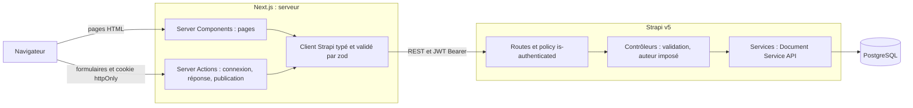
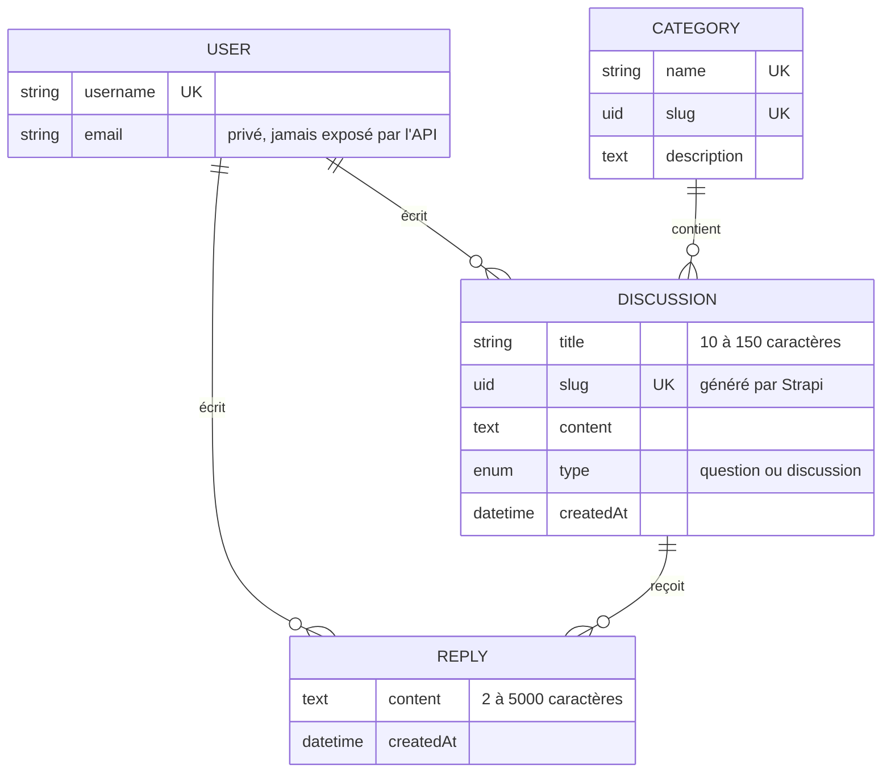

# Communauté Le Revenu

Dernière mise à jour : 2026-10-26

Test technique Développeur Full Stack : transformation d'une partie de la maquette HTML
« Communauté Le Revenu » en application **Next.js (App Router) + Strapi v5 + PostgreSQL**.

## Sommaire

- [Périmètre](#périmètre)
- [Prérequis](#prérequis)
- [Installation et lancement](#installation-et-lancement)
- [Comptes de démonstration](#comptes-de-démonstration)
- [Tests](#tests)
- [Architecture](#architecture)
- [Modèle de données](#modèle-de-données)
- [API Strapi](#api-strapi)
- [Sécurité et permissions](#sécurité-et-permissions)
- [Rendu, données et cache côté Next.js](#rendu-données-et-cache-côté-nextjs)
- [Limites connues et évolutions](#limites-connues-et-évolutions)
- [Dépannage](#dépannage)

## Périmètre

| Fonctionnalité | Réalisé |
|---|---|
| **A. Accueil** | Discussions issues de Strapi (titre, auteur, catégorie, nombre de réponses, date), filtre par catégorie, tri par date, pagination côté backend, lien vers le détail |
| **B. Détail** | URL propre `/discussions/<slug>`, contenu, auteur, date, catégorie, réponses ; publication d'une réponse enregistrée dans PostgreSQL via Strapi |
| **C. Création** | Formulaire `/publier` (titre ≥ 10 caractères, contenu, catégorie, type question/discussion), erreurs par champ, redirection vers la nouvelle discussion ; validation métier dans Strapi |
| **D. Utilisateurs et permissions** | Users & Permissions de Strapi, utilisateurs de démonstration, publication refusée sans authentification, auteur imposé côté serveur, permissions configurées dans Strapi |

Hors périmètre (présents uniquement dans la maquette) : sondages, billets de blog, points et badges,
mentions, événements, fiches au survol, notes de conception.

<sub>[↑ Sommaire](#sommaire)</sub>

## Prérequis

- **Node.js 22.12+** (voir `.nvmrc` ; Vitest 5 ne fonctionne pas sous Node 20)
- **npm** pour le backend, **pnpm** pour le frontend
- **Docker** (PostgreSQL)
- `openssl` pour générer les secrets locaux

<sub>[↑ Sommaire](#sommaire)</sub>

## Installation et lancement

### 1. Variables d'environnement

Aucun secret n'est versionné : chaque fichier `.env.example` sert de modèle.

```bash
cp .env.example .env
cp backend/.env.example backend/.env
cp frontend/.env.example frontend/.env.local
```

Renseigner ensuite :

- `.env` et `backend/.env` : **le même** `DATABASE_PASSWORD` (par exemple `openssl rand -hex 16`) ;
- `backend/.env` : les secrets Strapi (`APP_KEYS` = 4 valeurs séparées par des virgules,
  `API_TOKEN_SALT`, `ADMIN_JWT_SECRET`, `TRANSFER_TOKEN_SALT`, `JWT_SECRET`, `ENCRYPTION_KEY`),
  chacun généré avec `openssl rand -base64 32` ;
- `backend/.env` : `SEED_DEMO=true` et un `SEED_DEMO_PASSWORD` (8 caractères minimum).

### 2. Base de données

```bash
docker compose up -d
docker compose ps        # attendre l'état "healthy"
docker compose exec postgres createdb -U lerevenu lerevenu_test   # base des tests d'intégration
```

### 3. Backend (Strapi)

```bash
cd backend
npm ci
npm run develop
```

Au premier démarrage, Strapi synchronise les permissions, désactive l'inscription publique et crée les
données de démonstration (6 catégories, 4 utilisateurs, 6 discussions avec réponses).
Créer ensuite le compte administrateur sur http://localhost:1337/admin.

### 4. Frontend (Next.js)

Dans un second terminal :

```bash
cd frontend
pnpm install
pnpm dev
```

Application : http://localhost:3000

<sub>[↑ Sommaire](#sommaire)</sub>

## Comptes de démonstration

| E-mail | Pseudo |
|---|---|
| camille@demo.local | Camille_B |
| vincent@demo.local | Vincent_ETF |
| odile@demo.local | Odile.Retraite |
| thomas@demo.local | Thomas_PEA |

Mot de passe : la valeur de `SEED_DEMO_PASSWORD` dans `backend/.env`. Connexion sur `/connexion`.

<sub>[↑ Sommaire](#sommaire)</sub>

## Tests

```bash
cd backend
npm test                    # tests unitaires (validation des entrées, mapping des réponses)
npm run test:integration    # Strapi démarré sur la base lerevenu_test (PostgreSQL requis)

cd ../frontend
pnpm test                   # rendu de la liste et du détail, formulaires, redirections
pnpm exec tsc --noEmit
pnpm run lint
```

Cas exigés par l'énoncé :

| Cas | Où |
|---|---|
| Validation d'une discussion | `backend/tests/discussion-input.test.ts`, `backend/tests/integration/discussions.test.ts` |
| Refus d'une publication non authentifiée | `backend/tests/integration/replies.test.ts`, `discussions.test.ts` |
| Protection contre l'usurpation d'auteur | `backend/tests/integration/replies.test.ts`, `discussions.test.ts` |
| Affichage des discussions | `frontend/tests/discussion-list.test.tsx` |

<sub>[↑ Sommaire](#sommaire)</sub>

## Architecture



- **Toute la logique métier et la persistance passent par Strapi** : Next.js n'accède jamais à PostgreSQL.
- **Strapi** : contrôleurs fins (lecture de la requête, validation, réponse HTTP), services qui portent
  les requêtes via le Document Service API, fonctions pures de validation testées unitairement.
- **Next.js** : un client unique côté serveur (`lib/strapi/`) qui construit les URL, gère le cache,
  attache le JWT et valide chaque réponse avec zod.

<sub>[↑ Sommaire](#sommaire)</sub>

## Modèle de données



- `User` est le modèle du plugin Users & Permissions ; les relations `author` sont à sens unique pour ne pas
  modifier le schéma du plugin.
- `draftAndPublish` est désactivé : un contenu de membre est visible dès son enregistrement.
- Schémas : `backend/src/api/*/content-types/*/schema.json`.

<sub>[↑ Sommaire](#sommaire)</sub>

## API Strapi

| Méthode et route | Accès | Rôle |
|---|---|---|
| `GET /api/discussions?page&pageSize&sort&category` | public | Liste paginée (pageSize ≤ 50), tri `date:desc` ou `date:asc`, filtre par slug de catégorie, `replyCount` calculé par un `count(*)` groupé |
| `GET /api/discussions/slug/:slug` | public | Détail avec catégorie, auteur et réponses triées par date |
| `GET /api/discussions/:documentId` | public | Même forme que le détail (remplace le `findOne` natif) |
| `POST /api/discussions` | authentifié | Création : validation métier, auteur imposé, slug unique |
| `POST /api/replies` | authentifié | Réponse : validation, auteur imposé, discussion existante |
| `GET /api/categories` | public | Endpoint natif de Strapi |
| `POST /api/auth/local` | public | Connexion (Users & Permissions) |

Erreurs : `400` avec un message par champ dans `error.details.errors`, `401`/`403` sans authentification,
`404` pour une ressource inconnue. Les routes `update`/`delete` ne sont pas exposées.

<sub>[↑ Sommaire](#sommaire)</sub>

## Sécurité et permissions

- **Permissions définies par le code** (`backend/src/bootstrap/permissions.ts`), synchronisées à chaque démarrage :
  elles sont versionnées et identiques sur toutes les machines. Public : lecture ; Authenticated : lecture +
  création de discussions et de réponses.
- **Trois niveaux pour publier** : permission du rôle, policy `global::is-authenticated` sur la route,
  contrôleur qui impose `author = ctx.state.user` (tout `author` ou `slug` envoyé par le client est ignoré).
- **Aucune donnée personnelle exposée** : l'auteur est toujours renvoyé sous la forme `{ username }` ;
  `/api/users` et `/api/replies` ne sont pas lisibles publiquement.
- **Session** : le JWT Strapi est stocké dans un cookie `httpOnly`, `SameSite=Lax` (`Secure` en production),
  lu uniquement par le serveur Next ; les Server Actions vérifient l'origine des requêtes.
- **Contenu des membres** rendu comme du texte (aucun HTML interprété).
- Inscription publique désactivée (comptes de démonstration uniquement), redirection après connexion limitée
  aux chemins relatifs du site.

<sub>[↑ Sommaire](#sommaire)</sub>

## Rendu, données et cache côté Next.js

- **Server Components** pour l'accueil et le détail : données récupérées côté serveur, HTML complet dès la
  première réponse, adresse de Strapi jamais exposée au navigateur.
- **Filtre, tri et page dans l'URL** (`/?category=bourse&sort=date:asc`) : vues partageables, bouton
  précédent du navigateur fonctionnel, aucun JavaScript client nécessaire.
- **Client Components** limités aux formulaires (état, envoi en cours, conservation de la saisie en cas d'erreur)
  et à `error.tsx`.
- **Cache** : requêtes publiques mises en cache 30 s (discussions) et 5 min (catégories) ; requêtes portant
  un JWT jamais mises en cache (`no-store`). Après une réponse ou une publication, `revalidatePath`
  rafraîchit les pages concernées immédiatement.
- Les dates relatives sont calculées à la requête (`connection()`), une seule fois par page.
- Le mode Cache Components de Next 16 n'est pas activé : toutes les pages dépendent de la requête
  (URL, cookie de session, date).
- États gérés : `loading.tsx` (squelettes), `error.tsx` (Strapi indisponible), `not-found.tsx`
  (catégorie, page ou discussion inconnue), états vides (aucune discussion, aucune réponse).

<sub>[↑ Sommaire](#sommaire)</sub>

## Limites connues et évolutions

- Les réponses d'une discussion sont chargées en une fois : à paginer au-delà de quelques centaines.
- Pas de modification ni de suppression de contenu (nécessiterait une policy « propriétaire uniquement »).
- Pas de modération ni de signalement, pas de recherche plein texte.
- Logo reconstitué en CSS d'après la maquette : à remplacer par le fichier officiel.
- Évolutions possibles : intégration continue (lint, tests, scan de secrets), rate limiting sur la publication,
  index PostgreSQL ciblés selon les requêtes réelles, Cache Components pour les pages publiques.

<sub>[↑ Sommaire](#sommaire)</sub>

## Dépannage

| Symptôme | Cause et solution |
|---|---|
| `ECONNREFUSED 127.0.0.1:5432` au démarrage de Strapi | PostgreSQL n'est pas lancé : `docker compose up -d`, puis vérifier `docker compose ps` |
| `permission denied … docker.sock` (Linux) | Utilisateur hors du groupe `docker` : `sudo usermod -aG docker $USER`, puis se reconnecter |
| Le conteneur PostgreSQL s'arrête aussitôt | `DATABASE_PASSWORD` vide : vérifier `.env` à la racine, puis `docker compose down -v && docker compose up -d` |
| Port 5432 déjà utilisé | Un PostgreSQL local tourne : changer le port publié dans `docker-compose.yml` et `DATABASE_PORT` dans `backend/.env` |
| `[seed] SEED_DEMO_PASSWORD … is required` | Renseigner `SEED_DEMO_PASSWORD` (8 caractères minimum) dans `backend/.env` |
| Tests d'intégration : `database "lerevenu_test" does not exist` | `docker compose exec postgres createdb -U lerevenu lerevenu_test` |
| Tests d'intégration : `Cannot find package 'supertest'` | Dépendances non installées : `npm ci` dans `backend/` |
| Vitest refuse de démarrer | Node trop ancien : Node 22.12+ requis (`nvm use`) |
| Pages en erreur « momentanément indisponibles » | Strapi arrêté ou `STRAPI_URL` incorrect dans `frontend/.env.local` |

<sub>[↑ Sommaire](#sommaire)</sub>